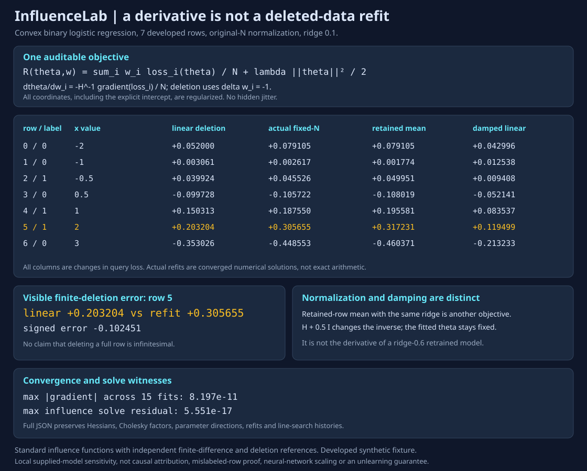

# InfluenceLab

Small convex influence functions, with a real deletion reference instead of a promise that a derivative predicts retraining.



InfluenceLab fits fully regularized binary logistic regression using safeguarded Newton steps, then differentiates one training row's sample weight. Every report keeps the fitted parameters, full Hessian, Cholesky factor, sample gradients, parameter directions, query-loss derivatives, linear-solve residuals and line-search histories. Optional refits compare the linear deletion prediction with converged finite deletion under two explicit normalization conventions.

Python 3.10+, standard library at runtime, no APIs, downloads or paid services.

## Run

```sh
python -m unittest discover -s tests -v
python -m influencelab demo > report.json
python -m influencelab audit examples/input.json > custom.json
python examples/render_demo.py --check
```

```python
from influencelab import audit, fit

report = audit(
    [[1, -2], [1, -1], [1, -.5], [1, .5], [1, 1], [1, 2], [1, 3]],
    [0, 0, 1, 0, 1, 1, 0],
    query=[1, 2], label=1, ridge=.1,
)
```

There is no automatic intercept or standardization. The constant first column above is an explicit **regularized** intercept. `fit` supports nonnegative weights and an explicit normalizer; `audit` starts from all-one weights. Inputs are small dense numeric arrays, not text, datasets or model checkpoints. See [DESIGN.md](DESIGN.md) for equations, limits and numerical behavior. [Full deterministic output](examples/demo.json).

## What the fixture actually shows

This seven-row synthetic fixture was developed alongside the implementation. It is not an untouched benchmark or a reproduction of a published experiment. The query is `(1,2)` with label 1, ridge is 0.1, and the original row count is 7. The fitted theta is approximately `(-0.275488, 0.220249)` and query loss is `0.614042`.

All values below are **changes in query loss when deleting a full row**. The linear prediction is a local approximation. "Actual" means a converged numerical refit, not exact rational arithmetic.

| Row | Linear fixed-N prediction | Actual fixed-N refit | Retained-row mean, same ridge | Damped linear, delta=0.5 |
|---|---:|---:|---:|---:|
| 0 | +0.052000 | +0.079105 | +0.079105 | +0.042996 |
| 1 | +0.003061 | +0.002617 | +0.001774 | +0.012538 |
| 2 | +0.039924 | +0.045526 | +0.049951 | +0.009408 |
| 3 | -0.099728 | -0.105722 | -0.108019 | -0.052141 |
| 4 | +0.150313 | +0.187550 | +0.195581 | +0.083537 |
| 5 | +0.203204 | +0.305655 | +0.317231 | +0.119499 |
| 6 | -0.353026 | -0.448553 | -0.460371 | -0.213233 |

For row 5, the signed linear-minus-refit error is `-0.102451`. Damping does not remove that approximation error in this fixture. No general ranking of approximations is claimed.

Fixed-N deletion keeps `sum(w_i * loss_i) / original_N + ridge * ||theta||^2 / 2`. Renormalizing by the remaining row count while retaining the same ridge changes the objective. In fact, fixed-N deletion is equivalent to the retained-row mean with ridge multiplied by `N/(N-1)`. Both references are reported separately.

The damped inverse uses `H + delta I` **at the original fit**. It is labeled an inverse approximation, not the true sample-weight derivative, and is not a retrained model with ridge `ridge + delta`.

## Verification

26 tests cover:

- Independent loss/gradient/curvature references, all gradient/Hessian finite differences, scalar fit versus a separate monotone bisection optimizer, and all influence coordinates versus two-sided weight-perturbed refits.
- Cholesky reconstruction, independent two-dimensional inverse, primal/adjoint agreement, solve residuals, weighted curvature sum-of-squares and strong-convexity parameter-error bounds.
- Actual finite deletion, the two normalization conventions, damping distinctions, local second-order remainder behavior, permutation and orthogonal-coordinate invariance, label complements, duplicates and zero/rank-deficient features.
- Backtracking on a dedicated developed stress fixture, explicit nonconvergence errors, stable extreme logits, strict inputs/JSON, no mutation or global RNG use, and byte-reproducible output.
- Three SVG tests check all 42 table cells and positions, the signed deletion error and fit count, full compressed report metadata, hidden refit-Hessian tampering and byte-exact regeneration.

CI runs Python 3.10-3.13, the demo/caller CLI paths, the SVG check and full-JSON parity from an installed four-module wheel outside the checkout. The demo's 15 base/deletion fits all have max absolute gradient at most `8.197e-11`; the undamped influence solve residual is at most `5.551e-17`. These are numerical residuals, not statistical uncertainty.

## Scope and attribution

The algorithm is the standard implicit influence-function derivative, not a new attribution method. The implementation, synthetic fixture, numerical references and reporting are original to this project.

- Pang Wei Koh and Percy Liang, [Understanding Black-box Predictions via Influence Functions](https://proceedings.mlr.press/v70/koh17a.html), ICML 2017, Section 2.1: inverse-Hessian upweighting and test-loss derivatives. InfluenceLab uses sample-weight units, hence its explicit `1/N` factor, and keeps ridge fixed outside the weighted data loss.
- Samyadeep Basu, Philip Pope and Soheil Feizi, [Influence Functions in Deep Learning Are Fragile](https://arxiv.org/abs/2006.14651): cautions against generalizing small convex results to deep nonconvex models. This project does not implement or benchmark neural-network influence.

No causal attribution, mislabeled-row proof, data-valuation theorem, influence confidence interval, finite-deletion accuracy guarantee, scalable inverse-Hessian method, privacy deletion or machine-unlearning guarantee. Positive ridge and convergence are required; the implementation refuses an unconverged result instead of computing influence at an arbitrary iterate. MIT licensed.
